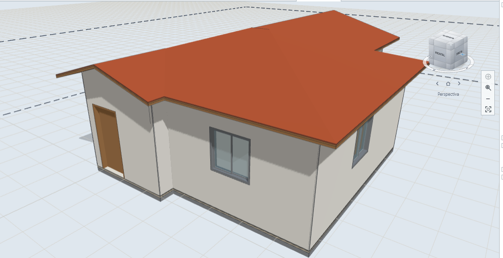
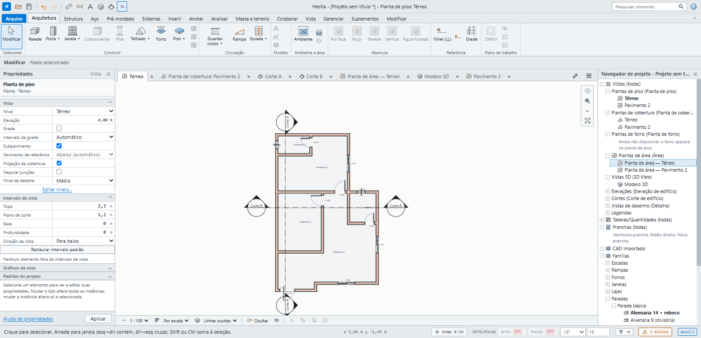
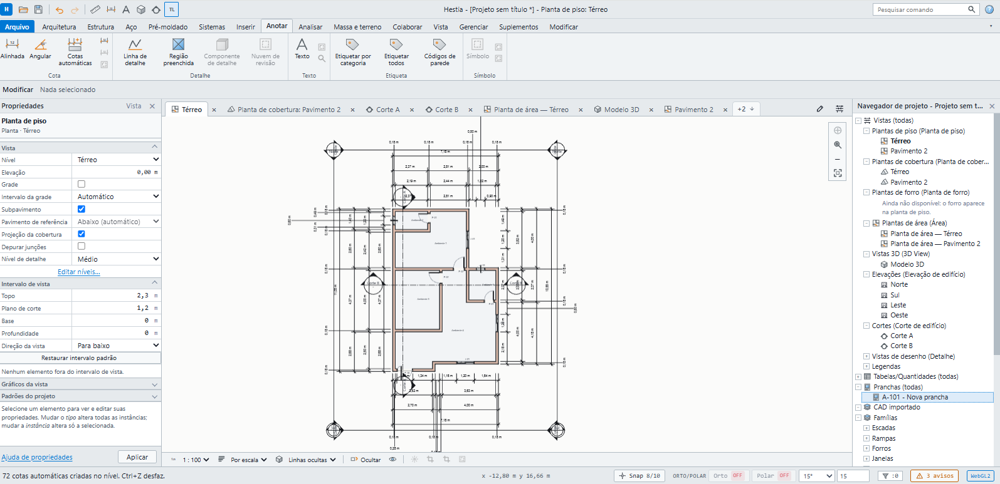
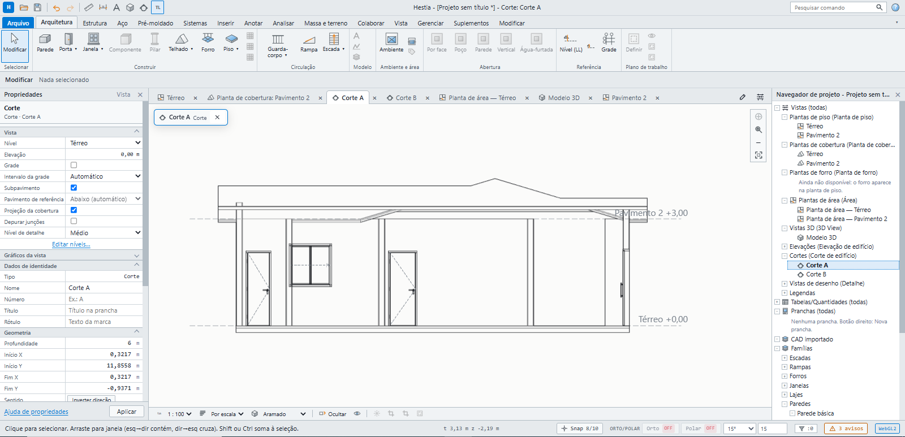
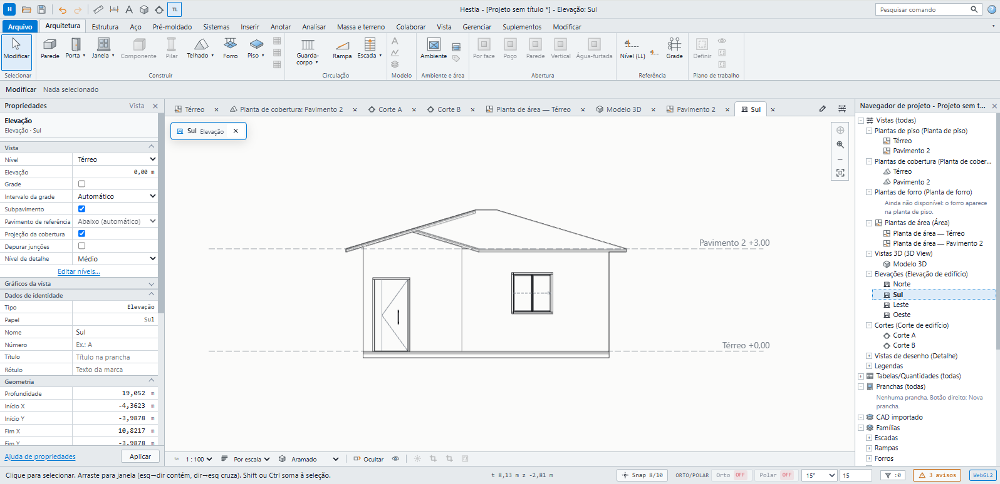
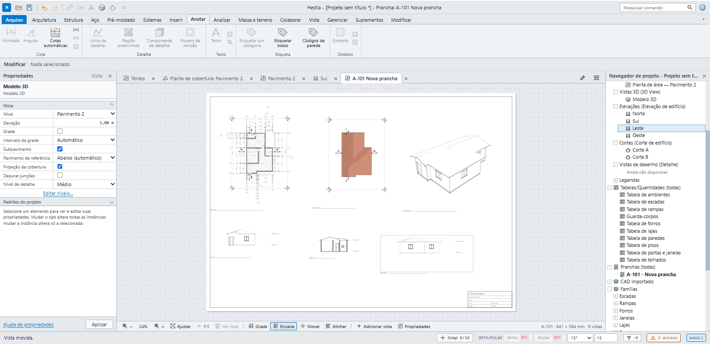
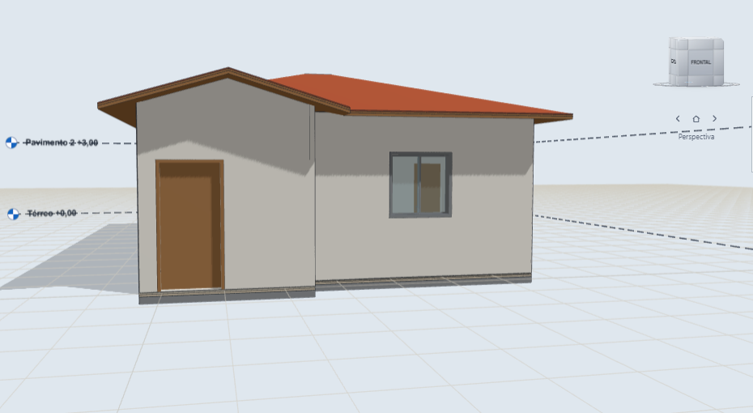

# Hestia

**Open source BIM for residential architecture.**
Model once, get plans, sections, elevations, schedules and sheets. In the browser or on Windows.

[**Open in the browser**](https://www.hestiabim.com/app) ·
[**Download for Windows**](https://github.com/engdennylsonsantos-cloud/Hestia/releases/latest) ·
[**Website**](https://www.hestiabim.com) ·
[**♥ Sponsor**](https://github.com/sponsors/engdennylsonsantos-cloud)

[Português](README.md) · English

 

## What it is

Hestia is BIM software built from scratch for residential design. A single model drives the
plan, the 3D view, sections, elevations, schedules and sheets, so a change in one view shows up
in all the others. Rendering runs on the GPU (WebGPU, falling back to WebGL2) and the geometry
kernel is separate from the UI, written in Rust.

## What it does

- **Residential modeling:** layered walls, floors, slabs, roofs, ceilings, doors and windows, stairs, ramps, railings and component families.
- **Type and instance:** changing a type updates every instance, as in professional BIM tools.
- **Automatic documentation:** floor, roof and area plans, sections, elevations, automatic dimensions, tags and sheets.
- **Schedules:** rooms, walls, slabs, floors, ceilings, doors, windows, roofs and stairs.
- **GPU rendering:** real-time 3D in the browser and in the desktop app.
- **Open formats:** exports IFC4, DXF, vector PDF and CSV, so your project is never locked in.

## See it working

<table>
  <tr>
    <td width="50%"> <b>Floor plan</b> with layered walls and section marks.</td>
    <td width="50%"> <b>Automatic dimensions:</b> 72 created with one command.</td>
  </tr>
  <tr>
    <td width="50%"> <b>Sections</b> generated from the same model.</td>
    <td width="50%"> <b>Elevations</b> with levels and heights.</td>
  </tr>
  <tr>
    <td width="50%"> <b>Sheets</b> with plan, roof, 3D, sections and elevations.</td>
    <td width="50%"> <b>3D</b> with levels, shadows and materials.</td>
  </tr>
</table>

## Getting started

**No install:** open [hestiabim.com/app](https://www.hestiabim.com/app).

**On Windows:** download the installer from the [latest release](https://github.com/engdennylsonsantos-cloud/Hestia/releases/latest) and run it.

The interface is currently in Portuguese.

## Support the project

Hestia is open source and free, and it stays that way. Your support helps fund maintenance,
new features (rendering, importers, schedules), documentation and user support.

Not able to give money? A star on the repository, bug reports in
[Issues](https://github.com/engdennylsonsantos-cloud/Hestia/issues), sharing the project with
colleagues and testing it on real projects all help a lot.

## Technical docs and contributing

The technical documentation (in Portuguese) is in [docs/](docs/) and is indexed in the
[main README](README.md#documentação-técnica). Contribution rules are in
[CONTRIBUTING.md](CONTRIBUTING.md), security reports in [SECURITY.md](SECURITY.md).

## License

MIT. See [LICENSE](LICENSE).
