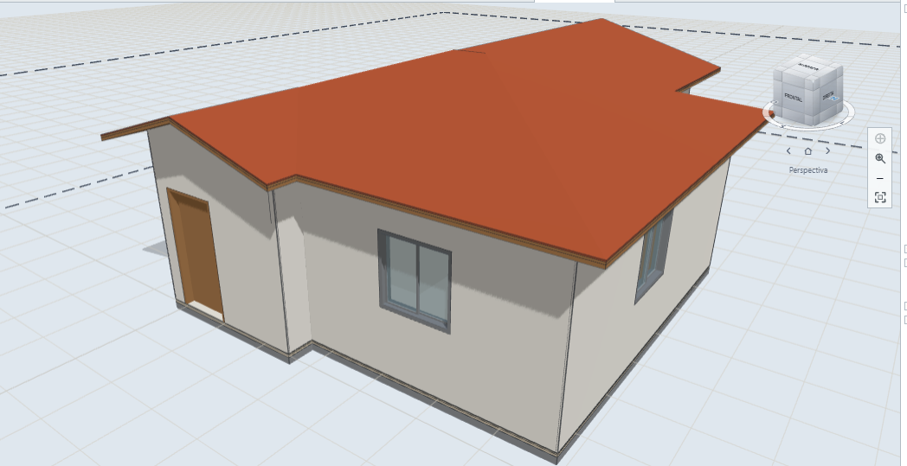
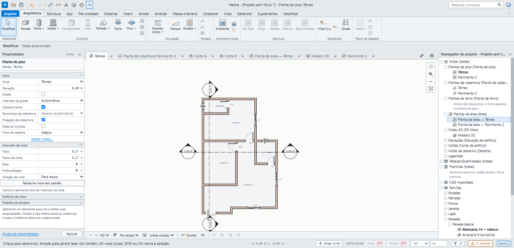
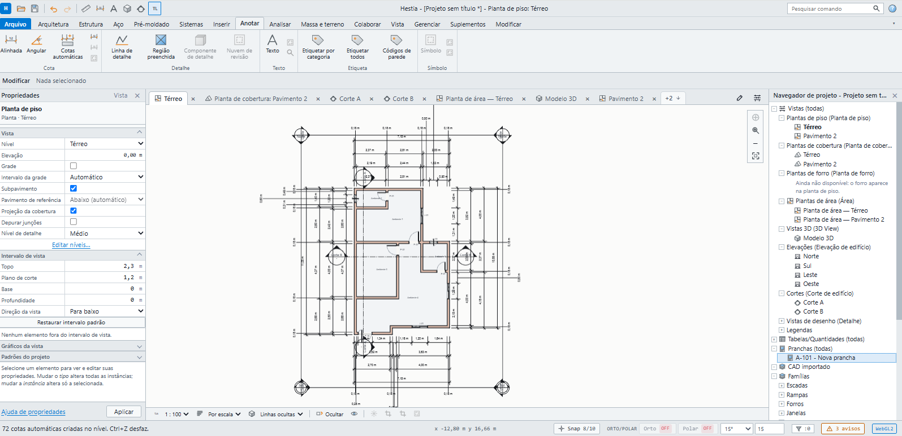
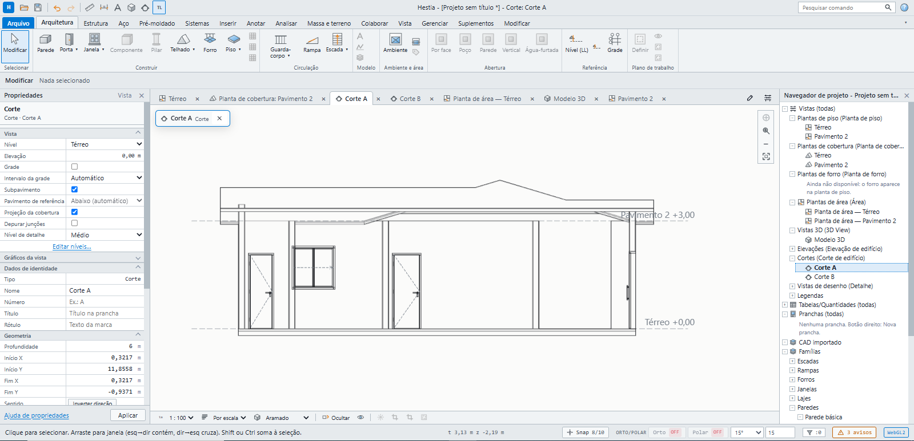
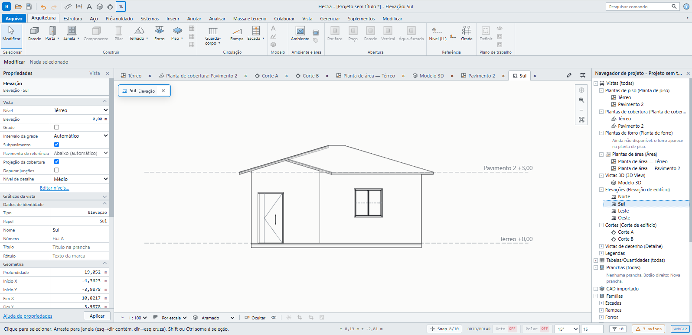
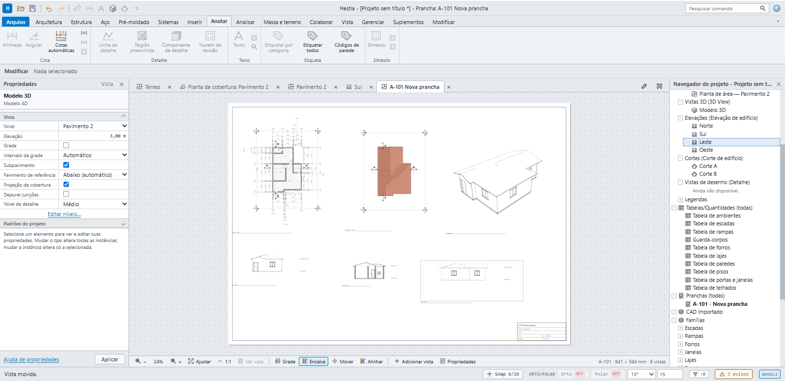
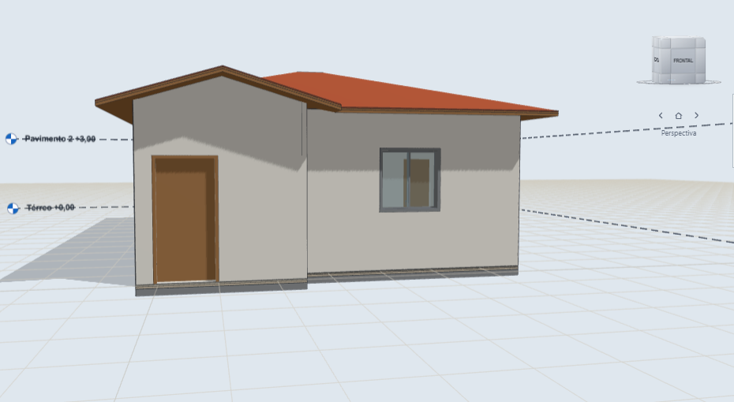

<div align="center">


# Hestia

**BIM open source para arquitetura residencial.**
Modele uma vez, gere plantas, cortes, elevações, quantitativos e pranchas. No navegador ou no Windows.

[](https://github.com/engdennylsonsantos-cloud/Hestia/releases/latest)
[](LICENSE)
[](https://github.com/engdennylsonsantos-cloud/Hestia/stargazers)
[](https://github.com/sponsors/engdennylsonsantos-cloud)

[**Abrir no navegador**](https://www.hestiabim.com/app) ·
[**Baixar para Windows**](https://github.com/engdennylsonsantos-cloud/Hestia/releases/latest) ·
[**Site**](https://www.hestiabim.com) ·
[**♥ Apoiar o projeto**](https://github.com/sponsors/engdennylsonsantos-cloud)

[English](README.en.md) · Português

<br>



</div>

## O que é

O Hestia é um programa de BIM feito do zero para o projeto de residências. Um único modelo
alimenta a planta, o 3D, os cortes, as elevações, as tabelas e as pranchas, então o que você
muda em uma vista aparece em todas as outras. A renderização usa a GPU (WebGPU, com queda
para WebGL2) e o núcleo geométrico é separado da interface, escrito em Rust.

## O que ele faz

- **Modelagem residencial:** paredes por camadas, pisos, lajes, telhados, forros, portas e janelas, escadas, rampas, guarda-corpos e famílias de componentes.
- **Tipo e instância:** mudar o tipo atualiza todas as instâncias, como em ferramentas BIM profissionais.
- **Documentação automática:** plantas de piso, cobertura e área, cortes, elevações, cotas automáticas, etiquetas e pranchas.
- **Quantitativos:** tabelas de ambientes, paredes, lajes, pisos, forros, portas, janelas, telhados e escadas.
- **Render por GPU:** visualização 3D em tempo real no navegador e no aplicativo.
- **Formatos abertos:** exporta IFC4, DXF, PDF vetorial e CSV, para o projeto não ficar preso a um programa.
- **Interface por abas de ferramentas,** com navegador de projeto, painel de propriedades e atalhos de teclado.

## Veja funcionando

<table>
  <tr>
    <td width="50%"><br><sub><b>Planta baixa</b> com paredes por camadas e símbolos de corte.</sub></td>
    <td width="50%"><br><sub><b>Cotas automáticas:</b> 72 cotas criadas com um comando.</sub></td>
  </tr>
  <tr>
    <td width="50%"><br><sub><b>Cortes</b> gerados a partir do mesmo modelo.</sub></td>
    <td width="50%"><br><sub><b>Elevações</b> com níveis e cotas de altura.</sub></td>
  </tr>
  <tr>
    <td width="50%"><br><sub><b>Pranchas</b> montadas com planta, cobertura, 3D, cortes e elevações.</sub></td>
    <td width="50%"><br><sub><b>3D</b> com níveis, sombras e materiais.</sub></td>
  </tr>
</table>

## Como começar

**Sem instalar nada:** abra [hestiabim.com/app](https://www.hestiabim.com/app).

**No Windows:** baixe o instalador na [última versão](https://github.com/engdennylsonsantos-cloud/Hestia/releases/latest) e execute.

## Apoie o projeto

O Hestia é open source e gratuito, e continua assim. Ele é desenvolvido com tempo e cuidado,
e o seu apoio ajuda a manter isso: correção de problemas, novos recursos (render,
importadores, quantitativos), documentação e suporte aos usuários.

[](https://github.com/sponsors/engdennylsonsantos-cloud)

Se não puder apoiar com dinheiro, ajuda muito: dar uma estrela no repositório, relatar problemas
em [Issues](https://github.com/engdennylsonsantos-cloud/Hestia/issues), compartilhar o projeto
com colegas e testar o programa em projetos reais.

---

## Suplementos

O Hestia aceita **suplementos**: pacotes `.hestiapkg` que acrescentam comandos, verificações, quantitativos, importadores e exportadores, famílias, materiais e ferramentas. Há três tipos: declarativo (só JSON), script (JavaScript em Worker isolado, sem rede) e processo externo (como o renderizador). O suplemento só pede; **você concede** cada permissão e pode revogá-la depois. Tudo fica em **Suplementos › Gerenciar suplementos** (atalho Alt+Shift+P). Para escrever um: `npm run suplementos:novo -- com.minhaempresa.nome`, depois `npm run suplementos:empacotar`. Guia: [docs/plugins/09-guia-do-autor.md](docs/plugins/09-guia-do-autor.md); referência: [docs/plugins/10-referencia-da-api.md](docs/plugins/10-referencia-da-api.md); exemplos em `plugins-exemplo/`.

## Documentação técnica

| Arquivo | Conteúdo |
|---|---|
| [docs/plugins/](docs/plugins/README.md) | Suplementos: especificação, guia do autor e referência da API |
| [docs/01-ARQUITETURA.md](docs/01-ARQUITETURA.md) | Camadas, GPU/CPU, núcleo em Rust/WASM, modelo de dados, comandos, regras de código |
| [docs/02-MODELO-BIM.md](docs/02-MODELO-BIM.md) | Como cada elemento funciona: tipos, camadas, parede, piso, laje, telhado, aberturas, escada |
| [docs/03-INTERFACE.md](docs/03-INTERFACE.md) | Layout, árvore de projeto, painel de propriedades, 2D x 3D, vistas, ferramentas |
| [docs/04-ROTEIRO.md](docs/04-ROTEIRO.md) | Fases de construção, critério de pronto de cada uma, o que fica fora da v1 |
| [docs/05-REFERENCIA-REVIT-ARCHICAD.md](docs/05-REFERENCIA-REVIT-ARCHICAD.md) | Como Revit e ArchiCAD funcionam de verdade, com fontes. **Manda sobre os demais** |
| [docs/paridade/](docs/paridade/paredes.md) | Checklist de paridade por elemento e porta de qualidade (≥ 95% antes de abrir o próximo) |
| [docs/07-STATUS-V1.md](docs/07-STATUS-V1.md) | O que a versão de teste já faz, o que falta e o roteiro de teste |
| [docs/06-PROPRIEDADES-E-DIALOGOS.md](docs/06-PROPRIEDADES-E-DIALOGOS.md) | Escopos de configuração, barra de opções, painel, diálogo do tipo, camadas, materiais |

### Princípios

1. O modelo guarda só o que o usuário decidiu. Tudo que é resolvido é derivado e cacheado.
2. Toda mudança é um comando, com desfazer e refazer.
3. 2D e 3D são vistas do mesmo modelo, nunca modelos separados.
4. Tipo e instância: mudar o tipo muda todas as instâncias.
5. Camadas, junções e quantitativos nascem da mesma estrutura de dados.
6. Núcleo sem interface: roda em Node e em teste, sem navegador.

## Rodar a partir do código

```bash
npm install
npm run dev
npm run check
```

Veja [docs/07-STATUS-V1.md](docs/07-STATUS-V1.md) para o estado atual e o roteiro de teste.

## Licença e contribuições

MIT. Veja [LICENSE](LICENSE). As regras de contribuição, licenciamento e marca
estão em [CONTRIBUTING.md](CONTRIBUTING.md), [LICENSING.md](LICENSING.md) e
[NOTICE](NOTICE).

A `main` recebe mudanças por pull request. Rode `npm run check` antes de abrir o
PR. Para falar de segurança, use o canal privado descrito em
[SECURITY.md](SECURITY.md). O código de conduta está em
[CODE_OF_CONDUCT.md](CODE_OF_CONDUCT.md); relatos são recebidos pelo formulário
privado indicado nele.
